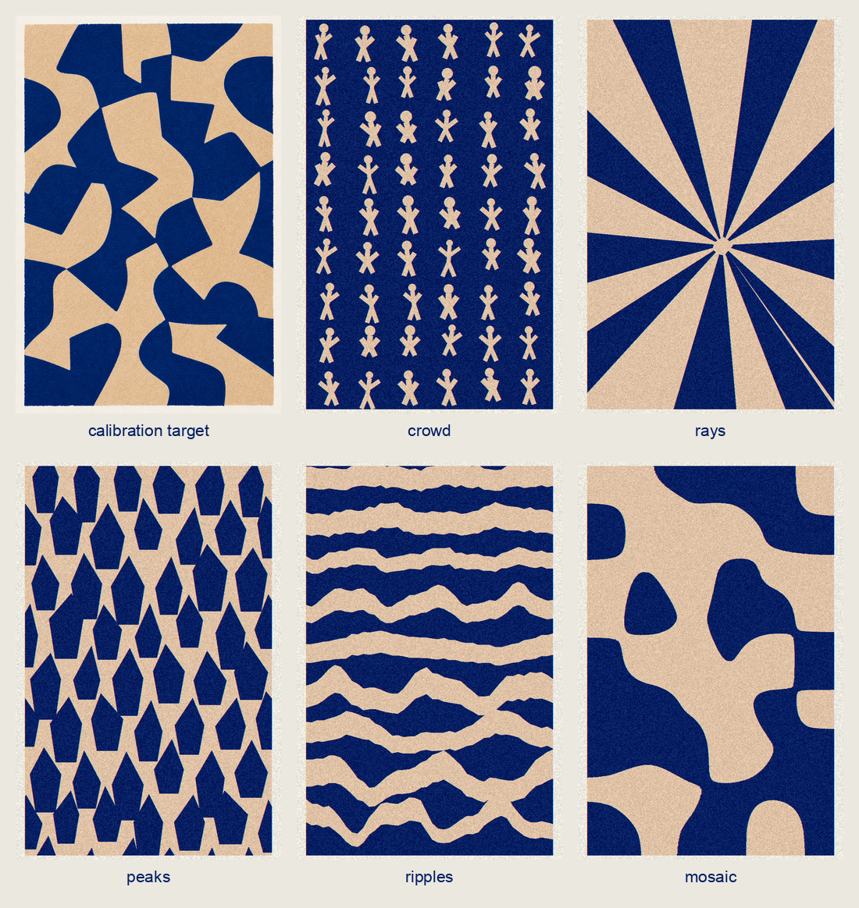

# riso

Style-locked flat-illustration pipeline: generate a semantic subject, construct
a geometric motif, or import an existing image → riso post-pass → export.
Consistency across a series is the deliverable; one-off pretty images are not.

Spec of record: [`docs/BRIEF.md`](docs/BRIEF.md).
Generation box: [`docs/generation-box.md`](docs/generation-box.md).

## Setup

```bash
source .venv/bin/activate      # Python 3.13 here, syntax kept 3.11-safe
pip install -e .               # puts the `riso` command on PATH
python -m pytest -q
```

`python -m riso` works identically if you would rather not install.

## Generate

```bash
riso gen "two cranes lowering a stair core into a timber building" \
  --style blueprint-coral --ar 2:3 --seed 304

riso gen "a crowd of tennis spectators seen from behind" --style tennis --ar 3:4
```

One command: ComfyUI generation → riso post-pass → a finished PNG in `out/`,
next to a JSON sidecar recording the prompt, seed, model, adapter and post
settings that made it. `--seed` to reproduce, `--keep-raw` to also write the
pre-post-pass frame, `riso styles` to list presets.

A style preset in `styles/*.toml` is the unit of series consistency — reference
image, strength, prompt wording, palette, crop and post settings in one file.
Two runs naming the same style differ in subject and seed and nothing else.

For original illustration work, the creative split is explicit: **your prompt
owns the subject, viewpoint and composition; the preset owns only the medium,
palette and press treatment.** `--show-prompt` prints the exact resolved prompt
without contacting ComfyUI. The `blueprint-coral` preset uses an abstract
reference made inside `riso`, an original three-ink palette, and no artist name
or external artwork. See [`docs/prompt-authored-illustrations.md`](docs/prompt-authored-illustrations.md).

`crop_keep` delivers the densest part of the frame at the size you asked for:
whatever the subject does not fill, the style reference fills with its own
shapes, so the crop trades that away. `--ar 3:4` still gives 3:4 at full size.

`docs/phase5-cropped-sheet.png` is three subjects through one preset, on the
first seed for each, no hunting. Earlier sheets are kept beside it as the
record of how it got there.

## Make geometric posters offline

```bash
riso motif crowd  --palette egypt-cobalt --ar 2:3 --seed 11
riso motif rays   --palette egypt-cobalt --ar 2:3 --seed 23
riso motif peaks  --palette egypt-cobalt --ar 2:3 --seed 37
riso motif ripples --palette egypt-cobalt --ar 2:3 --seed 41
riso motif mosaic --palette egypt-cobalt --ar 2:3 --seed 53
```

`riso motif` is the lane for sparse, graphic compositions that Flux is bad at.
It needs no model and no ComfyUI: five small generative systems draw flat plates,
then the same misregistration and grain pass used everywhere else finishes them.
`--density` changes repetition without changing the vocabulary. Same seed, same
PNG. Every result gets a sidecar recording motif, palette, density and press
settings, with no external model or adapter licence.



The first panel is a calibration target made with the built-in image tool; it is
not a production reference. The other five panels are local deterministic output.
The whole folder is retained as an internal study receipt and is **not public
post media** because it was developed too close to the source's palette and
motif vocabulary.
The full image-and-receipt manifest is in
[`docs/phase6-egypt-cobalt/`](docs/phase6-egypt-cobalt/README.md). Run
`riso motifs` and `riso palettes` to list what is available.

## Stylize an existing image

```bash
riso stylize sketch.png --palette egypt-cobalt --seed 7
```

This turns a drawing, render or photograph into flat palette plates and applies
the press treatment without involving ComfyUI. Its sidecar records a SHA-256 of
the source image so the result still has a reproducible receipt. Source-image
rights still apply; post-processing does not change provenance.
`luma` is the default mapping for off-palette images; use
`--palette-mode nearest` when the input already sits near the intended swatches.

## What this pipeline does and does not do

**It renders dense, repeating subjects.** Crowds, banks of faces, fields of
waves, stands of trees. That is not a limitation to work around, it is what the
look is made of: flat colour adjacency has to describe form without outlines or
shading, and it needs repeated elements to describe.

Subjects that work: `a crowd of tennis spectators seen from behind`,
`rows of striped umbrellas on a beach`, `a stand of pine trees on a hillside`,
`commuters on a station platform`, `a flock of birds over rooftops`.

**`riso gen` does not render a lone subject in open space.** One figure on an empty
court comes back with no figure at all — and not as a blank frame: whatever the
subject does not fill, the style reference fills with its own shapes. Measured
against four different references, all four failed the same prompt the same
way. No seed fixes it. Use `riso motif` when the composition is the subject.

**Hit rate on a dense subject, ten unhunted seeds, the shipped preset: 8 of 10
usable, 0 dead, five inks in 9 of 10.** The two weak frames are mostly flat
planes with a thin band of crowd.

**`riso gen` cannot tell you when the subject is missing.** It warns on a
featureless frame, but a frame full of confident abstraction is not featureless
— one such failure measured a tonal span of 0.326 against the 0.02 warning
threshold. It is a healthy, high-contrast, entirely subject-free image, and the
tool will report success. Look at what comes out.

## Post-pass

```python
from PIL import Image
from riso import post

art = post.compose(Image.open("in.png"), {
    "palette": "tennis-felt",                              # palettes/*.json
    "palette_mode": "luma",                                # or "nearest"
    "halftone": {"angle": 15, "cell": 5, "strength": 0.18},
    "misregister": {"px": 2},
    "grain": {"amount": 0.11, "seed": 7},                  # 2px tooth by default
})
art.save("out/art.png")
```

Steps run in a fixed order — `palette_lock → halftone → misregister → grain` —
and each is optional. Same seed in, byte-identical PNG out. Palettes are data:
add a JSON file to `palettes/` rather than hardcoding colours.

**Two palette mappings, because they fail in opposite directions.** `nearest`
picks the closest ink in Oklab and is right when the source already lives near
the palette; on a generated frame, which sits nowhere near it, every pixel can
land on the same ink and the image collapses to one flat field. `luma` ignores
source hue and maps lightness bands onto the palette's lightness order, so form
always survives. Style presets use `luma`.

Generated images go to `out/`, which is gitignored. Style references in `refs/`
are committed on purpose — they are the style identity.

## Style reference

`workflows/flux-redux-styleref.json` (ComfyUI API format) carries style from a
reference image while the prompt supplies the subject — the local equivalent of
`--sref`. Drive it with `riso.comfy`:

```python
from riso.comfy import Comfy, apply_params, load_workflow

comfy = Comfy()                                    # 127.0.0.1:8188, WSL-local
ref = comfy.upload_image("refs/style-riso-poster.png")
png = comfy.generate(apply_params(load_workflow(),
                                  prompt="a crowd of tennis spectators seen from behind",
                                  style_ref=ref, seed=4242))
```

Two rules, both measured, both in [`refs/srefs.md`](refs/srefs.md) with the runs
behind them:

- **The usable strength band is 0.05–0.15, not the 0.0–10.0 the node
  advertises.** At the node's own 1.0 default it reproduces the reference and
  ignores the prompt entirely. The workflow ships at 0.10; `tennis` runs 0.08.
- **A reference teaches rendering mode, so only ever use flat references.** A
  dimensional reference lets the base model fall back to photoreal no matter
  what the prompt says. The reference does not carry the palette — that comes
  from the post-pass — and its output is not literally flat either, which is
  why `palette_lock` is not optional.

## Models and licensing

**`flux1-schnell-fp8` is the default, and it is Apache-2.0.** The pipeline
stays on it: Redux style-referencing supports schnell, 4 steps keep iteration
fast, and the licence carries no commercial restriction — output can feed
@zohar_tito freely.

Flux dev and Flux Krea-dev are **non-commercial** and are not used here. If a
hero image is ever generated with one of them, that restriction travels with the
image. Record which model produced each image.

**One catch: the Redux adapter is not Apache-2.0.** `flux1-redux-dev` ships
under the FLUX.1 [dev] Non-Commercial License. The base model being Apache-2.0
does not launder that — any image made through the style-reference workflow
inherits the adapter's restriction, even though schnell itself is unrestricted.
Post-pass-only output (Phase 1, no Redux) stays fully Apache-2.0. Worth knowing
before anything from here is used commercially.
