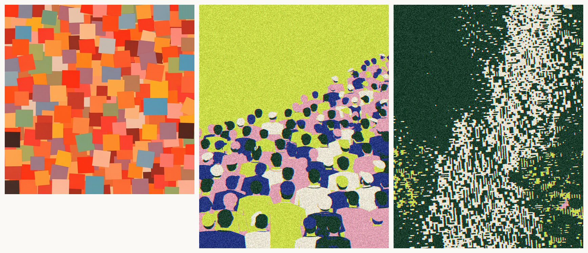

# Style reference ledger

Two kinds of reference live here. Log both — a style you cannot reproduce
next month is not a style.

Scope: these are historical observations from 2026-08-15 with
`flux1-schnell-fp8`, Redux and SigLIP, not model-wide rules. The initial strength
and reference comparison used one crowd prompt at seed 4242; later sections
state their own seed counts. Preset wording changed between phases, and the
full raw corpus is absent. Re-check changed prompts, references and runtimes
by looking at outputs; no subject, strength or outline guarantee follows.

## Midjourney sref codes

| code | look | `--sw` that worked | seen on |
|---|---|---|---|
| | | | |

## Local reference images

Drop the image in this folder and log it. These are committed on purpose —
they are the style identity, not scratch files.

| file | look | used by style preset |
|---|---|---|
| `style-flat-mosaic.png` | Dense interlocking flat regions, map-like, muted red/green/orange. No objects, no lettering, no shadows. Thin borders between regions. | `tennis` |
| `style-flat-planes.png` | Four large flat planes, cream/coral/yellow, soft curved boundaries. No objects, no borders, no shadows. | — (outline-free alternative, see the trade below) |
| `style-riso-poster.png` | Flat two-ink screenprint poster: teal/lilac blocks, cream ground, **one circle**. | — (retired 2026-08-15: the circle reproduced into output) |
| `style-stained-glass.png` | Art nouveau stained glass: heavy black leading, jewel tones, dense botanical pattern, backlit. Deliberately the opposite of the poster. | — (Phase 2 proof ref; **never** use as a live ref, see below) |

Both were generated locally on 2026-08-15 with `flux1-schnell-fp8` (Apache-2.0)
rather than scraped, so they are licence-clean and reproducible. Prompts are in
the Phase 2 record below.

## What Redux actually does with these

Measured 2026-08-15, `flux1-redux-dev` + `sigclip_vision_patch14_384` on
`flux1-schnell-fp8`, 4 steps, seed 4242, subject "a crowd of tennis spectators
seen from behind".

| `strength` (`multiply`) | result |
|---|---|
| 1.0 / 0.8 / 0.5 / 0.3 | Reference reproduced. Subject **gone** — the prompt contributes nothing. |
| 0.20 | Subject reduced to a silhouette strip; style dominates. |
| **0.10** | **Balance.** Subject reads clearly, style carries palette and flatness. |
| 0.05 | Subject dominant, style only tints the palette. |

`attn_bias` behaves the same way on the same scale — 0.1 works, 0.3+ swallows
the subject. There is no advantage either way at these values, so the workflow
stays on `multiply`.

**Tuning starting point from this sweep: 0.05–0.15.** The sampled higher
strengths copied the reference in this crowd/seed test. This does not establish
a universal usable band. Per-style overrides belong in `styles/*.toml`.

## The flat reference worked better in the two-reference comparison

Read off proof (a), where one subject ran against both refs at 0.10. The
stained-glass output is a **photograph**: real faces, depth of field,
photographic light, tinted dark red. The riso-poster output is genuinely flat
and silhouetted. Same strength, same subject, same seed — the difference is
that one reference is dimensional and the other is not.

The reference affected rendering mode as well as colour in this comparison.
Flat references are the starting recommendation for this pipeline; the pair
does not establish what every dimensional reference or prompt will do.

Two things a reference does *not* carry, also measured:

- **Not the palette.** The poster ref is teal/lilac/mauve/cream; its outputs
  are blue and violet. Not one reference colour survived. Redux carries "cool,
  few colours" — the palette comes from `palettes/*.json` in the post-pass.
- **Not flatness in the literal sense.** Raw output renders smooth vertical
  ramps in open sky. `palette_lock` is what makes the zero-gradients rule true,
  which is why it is not optional in a style preset.

## Strength and the prompt are one setting, not two (Phase 3, 6 seeds each)

| setting | result |
|---|---|
| 0.10, prompt = subject only | Flat, but the composition collapses on some seeds — 896×1152 seed 436484879 returned three empty colour bands, no subject at all. |
| 0.06, prompt = subject only | Subject sharp and specific — and **photoreal**. Real faces, gradient skies. Below the band the ref stops holding rendering mode. |
| **0.08, prompt carries "flat … no gradients"** | **Subject legible on all 6 seeds, flat on all 6.** What `tennis` ships. |

The reference cannot carry both flatness and subject clarity at one strength.
Say "flat" in words as well, and the strength is free to sit low enough for the
subject to survive. That is what `prompt_suffix` in a style preset is for.

Steps were swept too: 8 steps looks identical to 4 on schnell. Stay at 4.

## What a reference contributes, in the order it was learned

Every rule here cost a round of generation. Read this before minting a ref.

**1. Lettering.** The first poster ref carried a caption band and Redux
reproduced garbled text ("Terk, 2008") into every output. Cropped off.

**2. Any distinctive object, not just lettering.** The poster ref's single
white circle reappeared verbatim in Phase 3 output — a specific object, moved
across. Generalise: a reference contributes anything memorable in it. A good
ref is texture, palette and edge quality with **no memorable element**.

**3. Density transfers.** Measured over 10 seeds on one dense subject: a dense
reference (many small regions) produced crowds that fill the frame; a
four-plane reference produced the same subject compressed into a band with
most of the frame empty. The share of the frame taken by the single biggest
ink was identical at 59% for all three references tested — so density changes
what fills the frame, not how much of it is filled.

**4. Outlines come from the model, not from the reference. ~~Edge quality
transfers, including borders.~~ — corrected 2026-08-15, see below.**

The original claim here was that `style-flat-mosaic.png`'s thin region borders
transfer as outlines around figures, on the strength of a 2px-erosion measure
of the darkest ink: 55.7% solid in the Phase 4 crowd panel against 89–95% in
Phase 3. **That claim was wrong and the measurement did not support it.**

What actually happens, visible in `docs/outlines-come-from-the-model.png`: the
**raw generation already contains the outlines**, before the post-pass touches
it, with the bordered reference and the border-free one alike. `palette_lock`
carries them through; it does not create them. Flux draws contour lines when
asked for "flat editorial illustration" of a crowd, and that is the source.

Two ways the original reasoning failed, both worth remembering:

- **The metric measured the wrong thing.** 2px erosion asks whether the darkest
  ink is *blobby*, not whether outlines exist. A crowd of small dark heads is
  thin dark structure and scores low with no outlines present at all, and a
  frame with one big dark plane scores high with outlines all over it — which
  is exactly what happened: adding a "no outlines" clause to the prompt moved
  the planes ref from 39.4% to 92.7% while the outlines stayed visibly on the
  figures. **Do not use erosion solidity as an outline detector.**
- **The comparison was not like for like.** The Phase 3 numbers came from the
  published sheet and the Phase 4 numbers from full-resolution frames. Measured
  identically afterwards, the border-free planes ref scored *worse* than the
  bordered mosaic ref (48.7% against 55.7%) — the opposite of the claim.

**Solved the same day — by one phrase in the prompt.** See the section below.
The outlines were never a reference property, so they were never a reason to
prefer one reference over the other.

## Paper-medium wording reduced outlines in the tested crowds

`docs/outlines-fixed-by-the-medium-word.png` — raw and finished, both prompts.

The tested **"flat editorial illustration"** prompts produced heavy contours.
Naming a **paper** medium reduced them in the recorded comparisons. A learned
association with vector line art is an interpretation, not a verified account
of the model's training data or a guarantee for other prompts:

Scored on **two** axes, because the first version of this table only measured
lines and picked a winner that quietly lost ground on framing. *Subject* is the
share of the frame carrying real detail rather than handsome abstraction.

| prompt phrase | thin dark lines | subject |
|---|---|---|
| flat editorial illustration (was shipped) | 3.64% | 42.2% |
| + "no outlines, no linework" clause | 3.75% | 42.5% |
| flat screenprint | 3.13% | 39.7% |
| flat colour-block poster | 2.57% | 38.3% |
| flat flocked felt appliqué | 3.59% | 62.7% |
| flat cut-paper collage | 1.79% | 56.1% |
| cut-paper + "no outlines" clause | 0.94% | 55.1% |
| **torn paper collage, matte paper shapes** | **0.31%** | 44.8% → **61.1% cropped** |

For scale: a genuinely line-free image measures 0.00–0.04% on the same metric.
The 0.31% measurement is above that floor. The compared images showed less
linework than the 0.94% variant, including at collars and shoulders; neither
the metric nor this small comparison proves all outputs will be outline-free.

**The second axis is real and it nearly chose a different winner.** Torn paper
costs about 10 points of subject share against cut-paper, exactly as suspected:
ask for a paper medium and the space the subject does not occupy becomes paper.
It stays shipped because the alternative is visibly outlined, and because
`crop_keep` recovers the framing it costs — torn paper cropped reads 61.1%
subject, better than the outlined alternative uncropped.

The "no outlines" clause did nothing next to "editorial illustration"
(3.64 → 3.75) and halved the lines next to "cut-paper collage" (1.79 → 0.94).
These two observations support trying a different medium phrase before tuning
negative clauses for this preset, not a general law about negative prompts.

**Try substitution for this preset.** Deletion and negation did not help in the
reported comparison; substitution did. Other subjects, seeds and models may
respond differently.

### How to measure it — and how not to

`line_fraction`: a pixel counts as line if it is more than 0.10 Oklab lighter
3px away on **both** sides, in either axis. A plate boundary fails (one side
only), a large dark mass fails (both sides equally dark), grain fails
(measured pre-grain). Validated before use: 0.00% on the border-free ref,
0.04% on the bordered one, 1.75% on a raw crowd with visible contours.

The metric this replaces — erosion solidity — measured whether the dark ink was
blobby and was wrong for the job, which is how the reference got blamed for the
model's linework. **Validate a metric on a known-positive and a known-negative
before drawing a conclusion from it.**

### What it costs

`docs/outline-fix-what-it-costs.png` — three seeds, both prompts, whole frame.
Not free: the paper wording draws smaller figures packed denser, where the
illustration wording drew larger, crisper, individually-legible ones. The look
spec is unambiguous that forms read by colour adjacency only, so the clean
version ships, but the trade is real and visible in that image.

**5. One sparse prompt failed against four references.**
"A tennis player mid-serve seen from the baseline" was run against four
different references and produced no subject at all in every case — the poster
ref's blocks, the planes ref's planes, the mosaic ref's regions, and with a
patchwork-of-squares ref a literal checkerboard. A dense subject suppresses the
reference's motif; a sparse one hands the frame to it.

In these tests, reference shapes filled regions the subject did not occupy.
This motivates the diagnostic test below and `crop_keep`; it does not prove
that all sparse prompts or all seeds must fail.

## The acceptance test — no reference ships without it

**Hard rule: a candidate reference is judged on one dense subject and one
sparse subject before it is allowed into a style preset.** Dense-only testing
passes references that are unusable, and it will do so confidently.

Run both through the preset you intend to ship, same seed, changing nothing but
the subject, and look at the two images:

1. **Dense** — a crowd, a bank of faces, a field of repeated elements.
2. **Sparse** — one figure in open space.

Fail the candidate if the sparse frame shows the reference's own motif, if
either frame carries outlines (rule 4), or if anything memorable from the
reference appears in either (rules 1–2).

**The automated check will not catch this.** `riso gen` warns on a featureless
frame, but the sparse failure below scores a tonal span of 0.326 — far above
the 0.02 threshold — because a checkerboard is full of contrast. It is a
perfectly healthy frame containing none of the subject. Only looking finds it.

### Worked example — the patchwork candidate, rejected

Left, the candidate: dense flat squares, no lettering, no shadows, no borders,
no single memorable object. It looked like the best ref yet on every rule above.

Middle, the dense subject at seed 1: the strongest crowd this pipeline has
produced. **10 of 10 unhunted seeds legible.** On a dense-only test this
reference ships.

Right, the sparse subject — same reference, same seed, same preset, only the
subject changed: **a checkerboard.** The reference's squares, straight through,
with no tennis player anywhere in the frame. Rejected on the strength of this
one image, despite the middle panel.

`style-flat-mosaic.png` shipped instead — not because it is clean, but because
it fails less badly on sparse subjects.

## Historical hit rate notes (2026-08-15)

The ledger recorded ten consecutive seeds, 1–10, one dense subject ("a crowd
of tennis spectators seen from behind"), the preset at the time, no seed hunting:

- **0 of 10 dead frames**, and **10 of 10 legible crowds** on the mosaic ref.
- Ink coverage: 5 of 5 inks above 1% of the frame in 7 of 10.

An earlier README instead reported 8/10 usable and five inks in 9/10, also with
zero dead frames. These counts cannot be reconciled from the repository:
the individual raw frames, sidecars, immutable preset/runtime versions and
scoring criteria were not published. "Usable" and "legible" were not defined
as the same criterion. Neither account establishes a current preset hit rate.
A future benchmark needs a versioned corpus, sidecars, criteria and per-frame
metrics before a single current result can be quoted. Sparse-subject failures
remain separate observations, not a measured population success rate.

### Prompts that minted these refs

- `style-riso-poster.png` — "risograph screenprint poster, two ink colours only,
  flat geometric shapes, no outlines, heavy visible paper grain, minimal
  editorial composition, misregistered ink" (seed 900, cropped to drop captions)
- `style-stained-glass.png` — "ornate art nouveau stained glass window, thick
  black leading between every pane, saturated jewel tones, decorative botanical
  pattern, backlit glow" (seed 901)
- `style-flat-mosaic.png` — "dense interlocking flat colour regions like a map,
  filling the sheet edge to edge, even distribution, flat matte ink printed
  directly on paper, no shadows, no depth, no highlights, no objects, no
  symbols, no lettering, uniform screenprint grain" (seed 33)
- `style-flat-planes.png` — "risograph poster background, broad flat colour
  areas of unequal size meeting at soft irregular edges" + the same negative
  clauses (seed 33, cropped to drop faint corner lettering)

- rejected patchwork candidate (`docs/ref-test-patchwork.png`, left) —
  "crowded field of overlapping flat colour patches, busy all-over
  composition, no focal point, colour adjacency only" + the same negative
  clauses (seed 5). Not committed to `refs/`: it fails the acceptance test, and
  the prompt plus seed reproduces it if anyone wants to re-run the comparison.

Eighteen candidates were minted across four rounds to get two keepers. Most
were rejected on rule 2: circles, squares, grids, dots, torn-paper shadows.
Dense and object-free pull against each other — density wants many repeated
marks, and repeated marks are objects.
